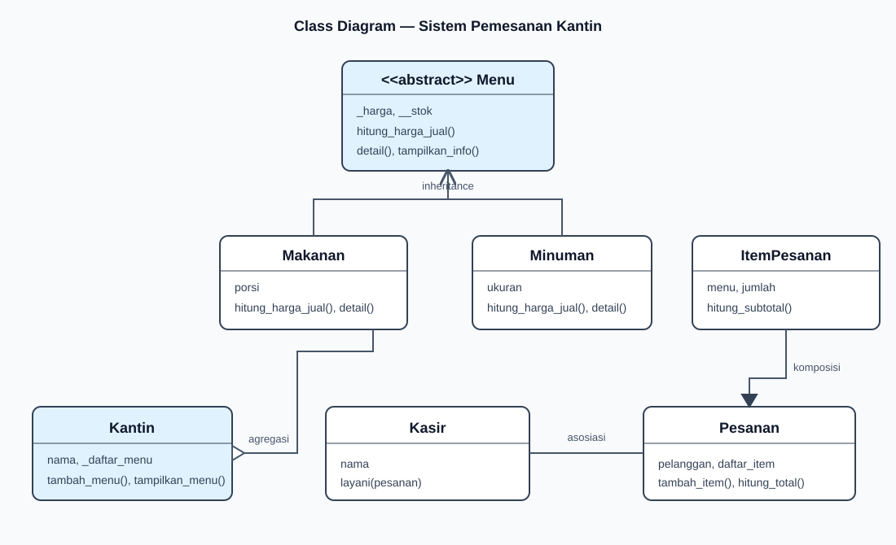
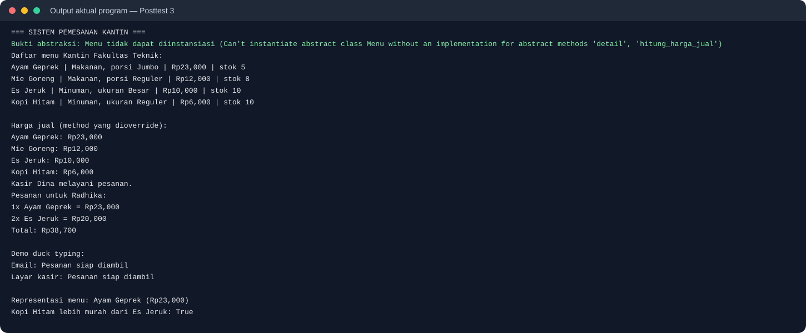

# Sistem Pemesanan Kantin

Posttest 3 - Mata Kuliah Pemrograman Berorientasi Objek (PBO)

## Deskripsi

Program ini melanjutkan simulasi kantin dari Posttest 2. Program mengelola menu makanan dan minuman, pesanan pelanggan, serta pelayanan kasir. Demonstrasi mencakup abstraksi, inheritance, polimorfisme, duck typing, operator overloading, dan tiga relasi UML.

## Class Diagram



- **Asosiasi — `Kasir` ke `Pesanan`:** method `Kasir.layani(pesanan)` menerima objek pesanan yang sudah dibuat pihak lain untuk dilayani; kasir hanya memakai referensi itu dan tidak memiliki siklus hidup pesanan.
- **Agregasi — `Kantin` ke `Menu`:** `Kantin.tambah_menu()` menyimpan menu yang dibuat dari luar kantin. Menu tetap bisa digunakan sesudah referensinya dilepas atau objek kantin dihapus, sehingga kepemilikannya tidak eksklusif.
- **Komposisi — `Pesanan` ke `ItemPesanan`:** `Pesanan.tambah_item()` membentuk dan menyimpan objek `ItemPesanan` sebagai bagian pesanan. Item tersebut merupakan baris rincian milik pesanan dan tidak dikelola sebagai entitas mandiri.

## Abstraksi dan Inheritance

`Menu` mewarisi `ABC` serta mendeklarasikan `hitung_harga_jual()` dan `detail()` sebagai abstract method. `Makanan` dan `Minuman` memanggil `super().__init__(...)`, memiliki atribut unik (`porsi` dan `ukuran`), serta mengimplementasikan kedua method tersebut. Method konkret `Menu.tampilkan_info()` digunakan bersama oleh kedua subclass. Atribut `_harga` bersifat protected dan `__stok` bersifat private.

Di dalam `main()`, pembuatan `Menu` dicoba dan `TypeError` ditangkap. Baris **“Bukti abstraksi: Menu tidak dapat diinstansiasi”** pada gambar output adalah bukti bahwa abstract class tidak bisa dibuat langsung.

## Polimorfisme

- **Pewarisan:** `hitung_harga_jual()` dioverride oleh `Makanan` dan `Minuman`, kemudian dipanggil dalam satu loop atas objek dari kedua subclass. Perhitungan harga jumbo dan ukuran besar menghasilkan perilaku berbeda.
- **Duck typing:** `EmailNotifier` dan `LayarKasir` tidak memiliki hubungan inheritance, tetapi keduanya menyediakan `kirim_pesan()`. Fungsi `umumkan()` memanggil method yang sama untuk keduanya.
- **Operator overloading:** `Menu.__str__()` memberi representasi teks menu dan `Menu.__lt__()` membandingkan harga jual melalui operator `<`.

## Prinsip SOLID (OCP)

`Kantin.tambah_menu()` bekerja dengan abstraksi `Menu`, dan `tampilkan_menu()` cukup memanggil method umum `tampilkan_info()`. Jenis menu baru dapat ditambahkan sebagai subclass yang memenuhi kontrak `Menu` tanpa mengubah cara `Kantin` menyimpan maupun menampilkan menu; ini menerapkan Open/Closed Principle.

## Screenshot Output



Output teks lengkap tersedia di [output-demo.txt](output-demo.txt).

## Menjalankan Program

```bash
python 25091060130-RadhikaAdityaArifin-PT-3.py
```
